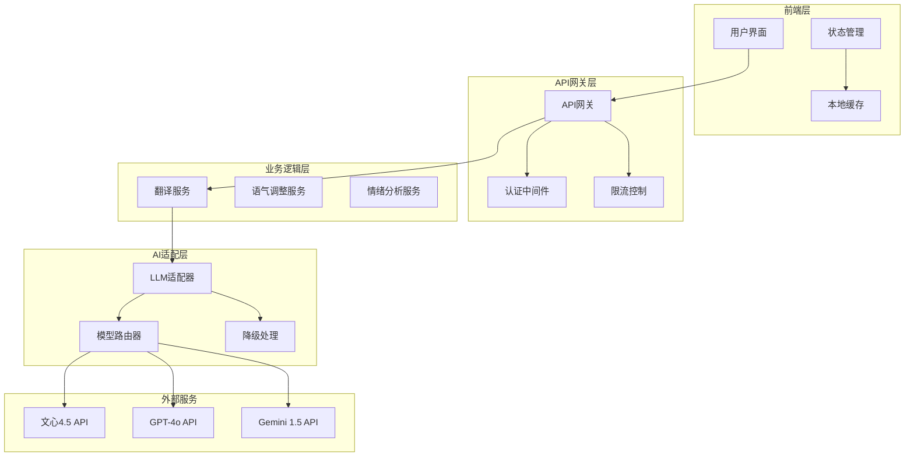
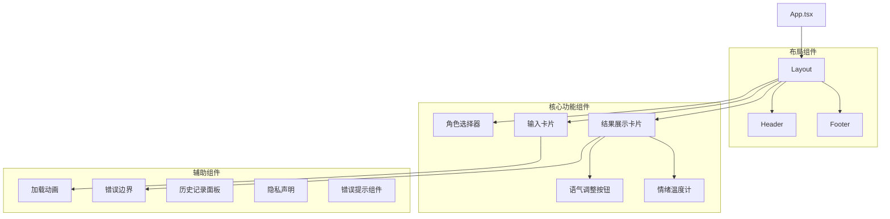
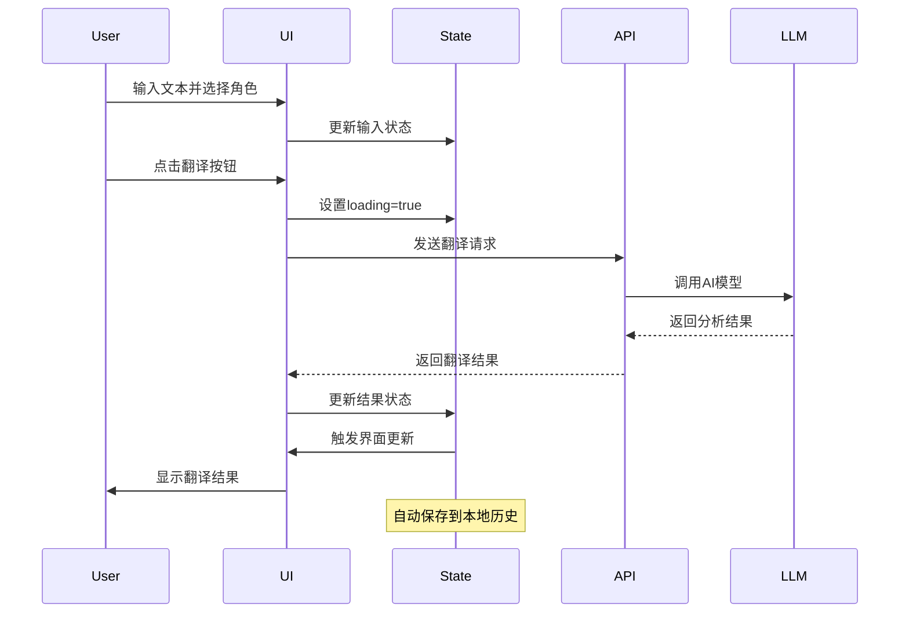
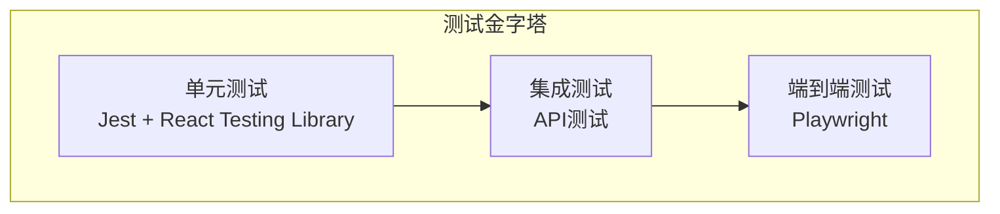

# NeuroBridge 神经多样性翻译器设计文档

## 概述

NeuroBridge是一个AI-Native的情感语义翻译器，专门设计用于改善ASD（自闭症谱系）用户和NT（神经典型）用户之间的沟通理解。系统通过深度语义分析，提供意图解释、误解预测和表达优化，从而减少沟通摩擦，促进相互理解。

### 设计原则

1. **AI-First架构**：每个功能模块都围绕AI能力设计
2. **用户体验优先**：简洁直观的界面，最小化认知负担
3. **隐私保护**：本地优先的数据处理，最小化数据收集
4. **可扩展性**：模块化设计支持未来功能扩展
5. **包容性设计**：避免病理化语言，强调沟通差异而非缺陷
6. **性能优先**：3秒内完成翻译，2秒内完成语气调整
7. **错误友好**：提供清晰的错误提示和解决方案

## 系统架构

### 整体架构图



### 技术栈选择

#### 前端技术栈
- **框架**: React 18 + TypeScript
- **构建工具**: Vite (快速开发和热重载)
- **样式**: Tailwind CSS + shadcn/ui组件库
- **状态管理**: Zustand (轻量级状态管理)
- **HTTP客户端**: Axios
- **本地存储**: localStorage API

#### 后端技术栈
- **框架**: FastAPI + Python 3.11
- **异步处理**: asyncio + aiohttp
- **API文档**: 自动生成OpenAPI文档
- **数据验证**: Pydantic
- **日志**: structlog
- **部署**: Docker容器化

#### AI集成
- **主要模型**: 文心4.5系列 (符合黑客松推荐)
- **备用模型**: GPT-4o, Gemini 1.5
- **模型切换**: 自动故障转移机制
- **提示工程**: 模板化prompt管理

## 组件设计

### 前端组件架构



### 核心组件详细设计

#### 1. RoleSelector (角色选择器)
```typescript
interface RoleSelectorProps {
  selectedRole: 'ASD' | 'NT' | 'Unknown';
  onRoleChange: (role: string) => void;
}

// 功能特性:
// - 三个选项的单选按钮组
// - 清晰的图标和说明文字
// - 选择状态的视觉反馈
// - 响应式设计适配移动端
```

#### 2. InputCard (输入卡片)
```typescript
interface InputCardProps {
  value: string;
  onChange: (value: string) => void;
  onSubmit: () => void;
  isLoading: boolean;
  placeholder: string;
}

// 功能特性:
// - 多行文本输入框
// - 字符计数显示
// - 提交按钮状态管理
// - 示例文本提示
// - 清空输入功能
```

#### 3. ResultCard (结果展示卡片)
```typescript
interface ResultCardProps {
  result: {
    intent: string;
    misread: string;
    rewrite: string;
    emotionScore: number;
    confidence: number;
  };
  onToneAdjust: (tone: 'direct' | 'warm' | 'empathy') => void;
  showEmotionAdvice: boolean; // 当情绪强度>70时显示额外建议
}

// 功能特性:
// - 四个信息区块的卡片布局
// - 可复制文本功能
// - 语气调整按钮集成（直接、温和、共情三种选项）
// - 情绪温度计可视化
// - 高情绪强度时的额外沟通建议
// - 动画过渡效果
// - 置信度显示
```

#### 4. EmotionMeter (情绪温度计)
```typescript
interface EmotionMeterProps {
  score: number; // 0-100
  size?: 'small' | 'medium' | 'large';
  showAdvice?: boolean; // 当score>70时显示
}

// 功能特性:
// - 圆形进度条显示
// - 颜色渐变 (冷色->暖色)
// - 数值和文字描述（低/中/高情绪强度）
// - 动画效果
// - 可配置尺寸
// - 高情绪强度时显示额外沟通建议
```

#### 5. HistoryPanel (历史记录面板)
```typescript
interface HistoryPanelProps {
  history: HistoryItem[];
  onSelectItem: (item: HistoryItem) => void;
  onDeleteItem: (id: string) => void;
  onClearAll: () => void;
}

// 功能特性:
// - 显示最近10条翻译记录
// - 时间戳和预览文本
// - 单条删除和全部清空
// - 点击查看详细结果
// - 本地存储管理
```

#### 6. PrivacyNotice (隐私声明组件)
```typescript
interface PrivacyNoticeProps {
  onAccept: () => void;
  visible: boolean;
}

// 功能特性:
// - 明确的隐私保护声明
// - 医疗免责声明
// - 数据处理说明
// - 用户同意确认
```

## 数据模型

### 核心数据结构

```typescript
// 用户角色类型
type UserRole = 'ASD' | 'NT' | 'Unknown';

// 语气类型
type ToneType = 'direct' | 'warm' | 'empathy';

// 翻译请求
interface TranslationRequest {
  speaker: UserRole;
  listener: UserRole;
  text: string;
  language: 'zh' | 'en';
}

// 翻译结果
interface TranslationResult {
  intent: string;          // 真实意图
  misread: string;         // 可能误解
  rewrite: string;         // 改写建议
  emotionScore: number;    // 情绪强度 0-100
  confidence: number;      // 结果置信度
  processingTime: number;  // 处理时间(ms)
}

// 语气调整请求
interface ToneAdjustRequest {
  baseText: string;
  targetTone: ToneType;
  targetAudience: UserRole;
  language: 'zh' | 'en';
}

// 历史记录
interface HistoryItem {
  id: string;
  timestamp: number;
  request: TranslationRequest;
  result: TranslationResult;
  adjustments?: ToneAdjustRequest[];
}

// 应用状态
interface AppState {
  currentRole: UserRole;
  inputText: string;
  isLoading: boolean;
  currentResult: TranslationResult | null;
  history: HistoryItem[]; // 最多存储10条记录
  error: string | null;
  privacyAccepted: boolean;
  showHistory: boolean;
}

// 错误状态
interface ErrorState {
  type: 'network' | 'timeout' | 'invalid_input' | 'api_error' | 'unknown';
  message: string;
  retryable: boolean;
  timestamp: number;
}
```

### 数据流设计



## API接口设计

### RESTful API规范

#### 1. 翻译接口
```http
POST /api/v1/translate
Content-Type: application/json

{
  "speaker": "ASD",
  "listener": "NT", 
  "text": "我不知道为什么你要生气，这不合逻辑。",
  "language": "zh"
}

Response:
{
  "success": true,
  "data": {
    "intent": "我希望理解你情绪背后的原因，并非否定你的情绪",
    "misread": "你在否定我的感受/指责我不理性",
    "rewrite": "我不是在否定你的感受，我只是想更明白你为什么会难过。",
    "emotionScore": 62,
    "confidence": 0.87,
    "processingTime": 1240
  },
  "timestamp": "2024-10-19T12:00:00Z"
}
```

#### 2. 语气调整接口
```http
POST /api/v1/tone-adjust
Content-Type: application/json

{
  "baseText": "我不是在否定你的感受，我只是想更明白原因。",
  "targetTone": "empathy",
  "targetAudience": "NT",
  "language": "zh"
}

Response:
{
  "success": true,
  "data": {
    "adjustedText": "我理解你现在不好受。等你觉得OK时，能和我说说发生了什么吗？",
    "confidence": 0.91,
    "processingTime": 800
  }
}
```

#### 3. 健康检查接口
```http
GET /api/v1/health

Response:
{
  "status": "healthy",
  "services": {
    "wenxin": "available",
    "gpt": "available", 
    "gemini": "limited"
  },
  "uptime": 3600,
  "version": "1.0.0"
}
```

## AI模型集成设计

### LLM适配器架构

```python
from abc import ABC, abstractmethod
from typing import Dict, Any, Optional

class LLMAdapter(ABC):
    """LLM适配器基类"""
    
    @abstractmethod
    async def translate(self, request: TranslationRequest) -> TranslationResult:
        pass
    
    @abstractmethod
    async def adjust_tone(self, request: ToneAdjustRequest) -> str:
        pass
    
    @abstractmethod
    def is_available(self) -> bool:
        pass

class WenxinAdapter(LLMAdapter):
    """文心4.5适配器"""
    
    def __init__(self, api_key: str, secret_key: str):
        self.api_key = api_key
        self.secret_key = secret_key
        self.base_url = "https://aip.baidubce.com"
    
    async def translate(self, request: TranslationRequest) -> TranslationResult:
        # 实现文心4.5的翻译逻辑
        pass

class ModelRouter:
    """模型路由器 - 负责模型选择和故障转移"""
    
    def __init__(self):
        self.adapters = {
            'wenxin': WenxinAdapter(),
            'gpt': GPTAdapter(),
            'gemini': GeminiAdapter()
        }
        self.priority = ['wenxin', 'gpt', 'gemini']
    
    async def route_request(self, request: TranslationRequest) -> TranslationResult:
        for model_name in self.priority:
            adapter = self.adapters[model_name]
            if adapter.is_available():
                try:
                    return await adapter.translate(request)
                except Exception as e:
                    logger.warning(f"Model {model_name} failed: {e}")
                    continue
        
        raise Exception("All models unavailable")
```

### Prompt工程设计

#### 翻译Prompt模板
```python
TRANSLATION_PROMPT_TEMPLATE = """
你是NeuroBridge，一个专业的神经多样性沟通翻译器。你的任务是帮助ASD和NT用户更好地理解彼此的表达。

输入信息：
- 说话者类型：{speaker}
- 听话者类型：{listener}  
- 原始文本："{text}"

请分析并输出JSON格式结果：
{{
  "intent": "说话者的真实意图（客观、无评判）",
  "misread": "听话者可能产生的误解（基于沟通风格差异）", 
  "rewrite": "更适合听话者理解的表达方式",
  "emotionScore": 情绪强度数值(0-100)
}}

注意事项：
1. 避免病理化语言，强调沟通风格差异
2. 保持客观中性，不做价值判断
3. 重写的表达要保持原意但更易理解
4. 情绪分数基于语言强度和情感色彩
"""

TONE_ADJUST_PROMPT_TEMPLATE = """
请将以下文本调整为{tone}语气，使其更适合{audience}理解：

原文："{text}"

语气要求：
- direct: 直接明确，减少歧义
- warm: 温和友善，增加情感连接  
- empathy: 共情理解，先认同再表达

只输出调整后的文本，不要其他解释。
"""
```

## 错误处理策略

### 错误分类和处理

```typescript
enum ErrorType {
  NETWORK_ERROR = 'NETWORK_ERROR',
  API_TIMEOUT = 'API_TIMEOUT', 
  INVALID_INPUT = 'INVALID_INPUT',
  MODEL_UNAVAILABLE = 'MODEL_UNAVAILABLE',
  RATE_LIMIT = 'RATE_LIMIT',
  UNKNOWN_ERROR = 'UNKNOWN_ERROR'
}

interface ErrorHandler {
  type: ErrorType;
  message: string;
  action: string;
  retryable: boolean;
}

const ERROR_HANDLERS: Record<ErrorType, ErrorHandler> = {
  [ErrorType.NETWORK_ERROR]: {
    type: ErrorType.NETWORK_ERROR,
    message: '网络连接失败，请检查网络设置',
    action: '重试',
    retryable: true
  },
  [ErrorType.API_TIMEOUT]: {
    type: ErrorType.API_TIMEOUT,
    message: 'AI服务响应超时，请稍后重试',
    action: '重试',
    retryable: true
  },
  [ErrorType.INVALID_INPUT]: {
    type: ErrorType.INVALID_INPUT,
    message: '请输入有效的文本内容',
    action: '修改输入',
    retryable: false
  }
  // ... 其他错误类型
};
```

### 降级策略

1. **模型降级**：主模型不可用时自动切换备用模型
2. **功能降级**：复杂功能失败时提供简化版本
3. **缓存降级**：网络失败时使用本地缓存结果
4. **静态降级**：所有AI服务不可用时显示预设示例

## 测试策略

### 测试金字塔



### 测试用例设计

#### 单元测试重点
- 组件渲染和交互
- 状态管理逻辑
- 工具函数和数据处理
- 错误边界处理

#### 集成测试重点  
- API接口功能
- 模型适配器切换
- 数据流完整性
- 错误处理机制

#### E2E测试场景
- 完整的翻译流程
- 语气调整功能
- 历史记录管理
- 错误恢复流程

## 性能优化

### 前端优化
- **代码分割**：路由级别的懒加载
- **组件优化**：React.memo和useMemo
- **资源优化**：图片压缩和CDN加速
- **缓存策略**：API响应缓存和本地存储

### 后端优化
- **异步处理**：非阻塞I/O操作
- **连接池**：数据库和HTTP连接复用
- **缓存层**：Redis缓存热点数据
- **负载均衡**：多实例部署

### AI模型优化
- **请求合并**：批量处理相似请求
- **结果缓存**：相同输入复用结果
- **模型预热**：提前加载常用模型
- **智能路由**：根据负载选择最优模型

## 安全考虑

### 数据安全
- **输入验证**：严格的输入参数校验
- **输出过滤**：防止恶意内容输出
- **传输加密**：HTTPS和API密钥加密
- **存储安全**：敏感数据加密存储

### 隐私保护
- **最小化收集**：只收集必要的功能数据
- **本地优先**：优先使用本地存储
- **匿名化处理**：去除个人标识信息
- **用户控制**：提供数据删除选项

### API安全
- **认证授权**：API密钥和访问控制
- **限流保护**：防止API滥用
- **监控告警**：异常访问检测
- **审计日志**：完整的操作记录

这个设计文档为NeuroBridge项目提供了全面的技术架构和实现指导，确保在6小时的黑客松时间内能够高效开发出功能完整的MVP产品。